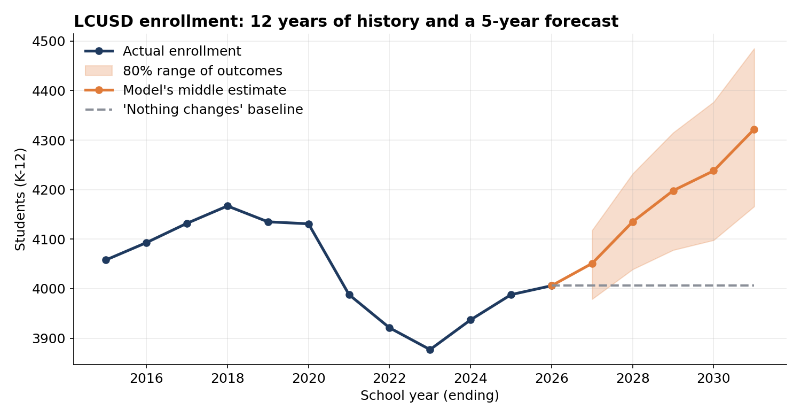
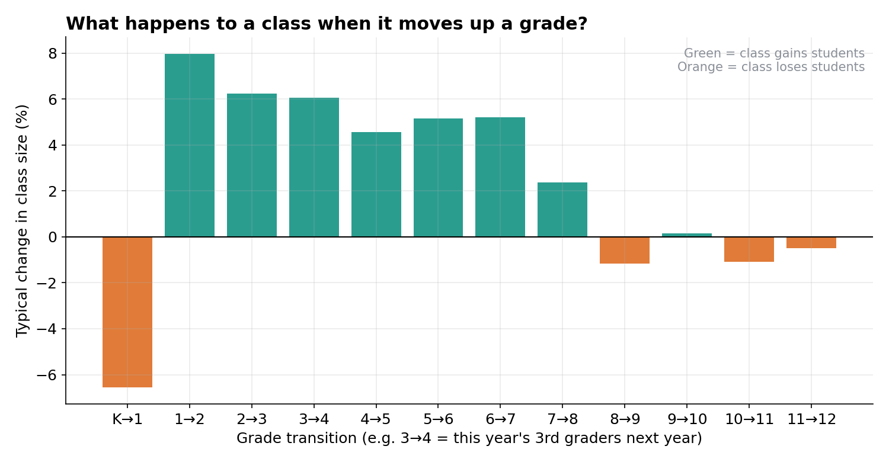
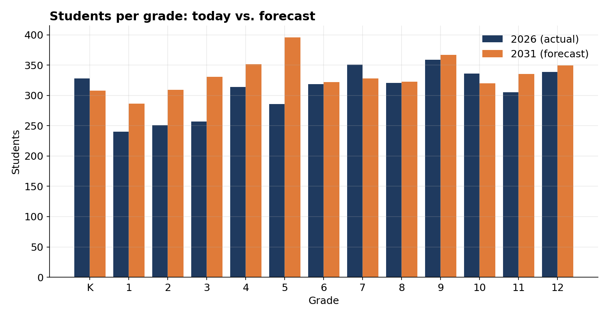
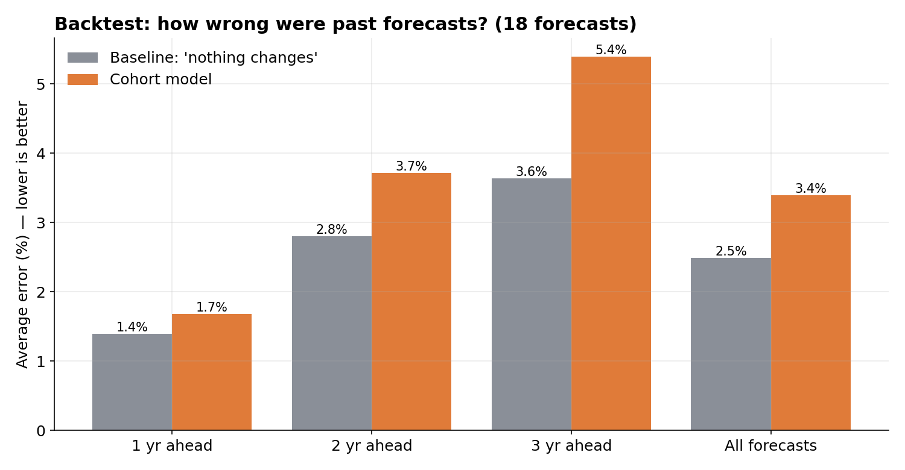
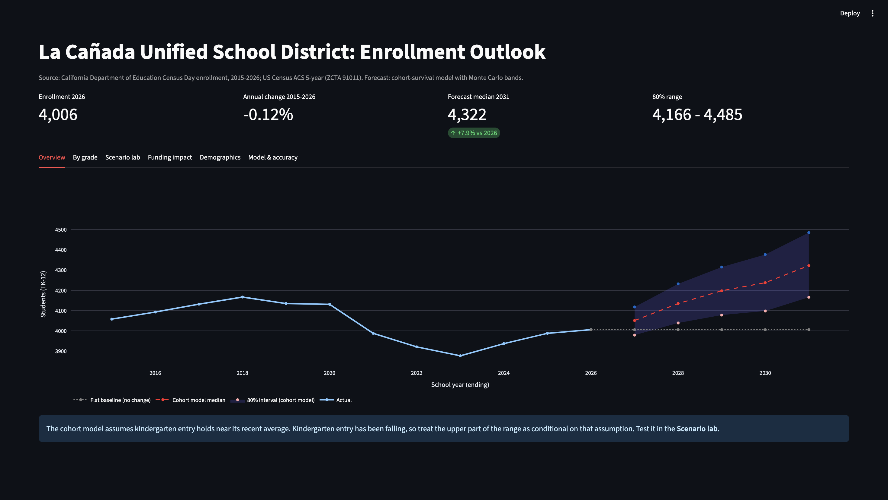
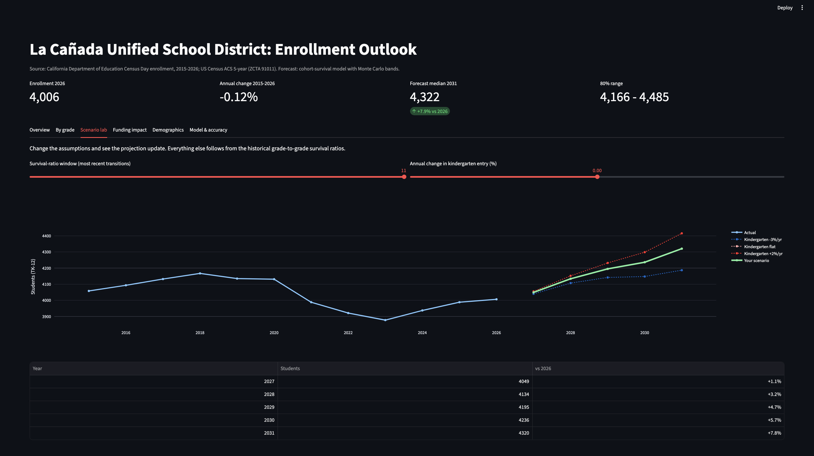
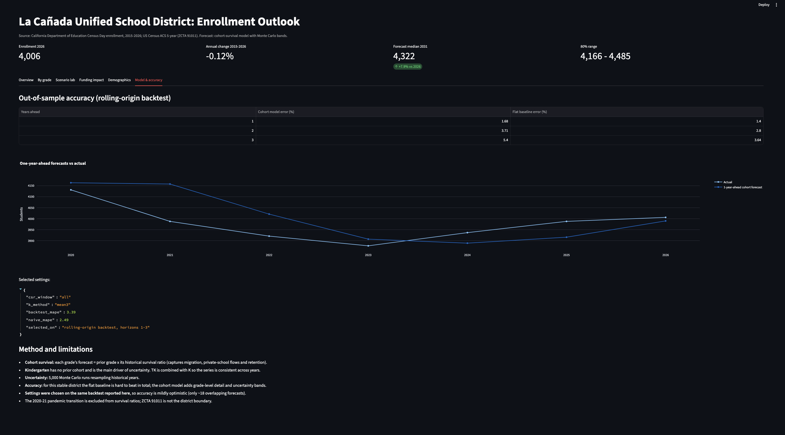
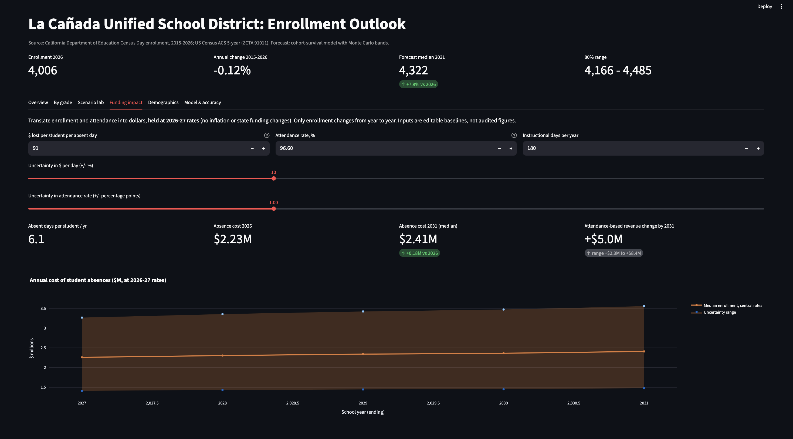

# LCUSD Enrollment Forecast

**How many students will be enrolled in La Canada Unified School District over the next five years, and how sure can we be?**

An end-to-end data project: this project collects public enrollment and Census data, builds a forecasting model, tests that model against history, and presents the results in an interactive dashboard.



## The short version (basic english)

- LCUSD had **4,006 students** in 2026. Over the last 12 years enrollment has drifted down by about **0.12% per year**, which is very stable.
- The model's middle estimate for 2031 is **4,322 students**, with an **80% range of 4,166–4,485 students** .
- **Important note:** when I tested the model on past years, a simple "nothing changes" guess was *slightly more accurate* overall (2.5% average error vs. 3.4%). So the model's value is **grade-by-grade detail and a range of outcomes**, not beating the simple guess on the total. The forecast is best used as a "what if" tool, not a full prediction.
- The rise in the forecast depends mostly on one assumption: how large each new kindergarten class will be. The dashboard lets you change that assumption and see the effect.

## How the forecast works

**Step 1 — Follow each class as it moves up.**
If 300 third-graders are enrolled this year, how many fourth-graders will there be next year? Families move in and out of the district, and some switch to private school, so it's rarely exactly 300. Suppose it's usually about 303. Then the "survival ratio" for grade 3→4 is 303 ÷ 300 = 1.01. The model measures this ratio for every grade, using every past year.



**Step 2 — Apply those ratios to today's classes.**
This year's 4th grade × its ratio = next year's 5th grade, and so on up through 12th grade. This method is called **cohort survival**.

**Step 3 — Kindergarten is the wildcard.**
Incoming kindergartners have no earlier grade to build from, so they're forecast separately from recent kindergarten sizes. Transitional kindergarten (TK) is combined with kindergarten so the numbers stay comparable over time. This is the biggest source of uncertainty in the model.

**Step 4 — Show a range, not one number.**
The model runs **5,000 simulations**. Each one randomly picks a past year's pattern of class changes and a plausible kindergarten size. The spread of the results gives the shaded range in the chart above.



## How accurate is it?

I used a **backtest**: pretend it's an earlier year, forecast the next few years using only the data available then, and compare against what actually happened. I repeated this for many starting years (18 forecasts in total).



| Forecast horizon | Cohort model error | "Nothing changes" error |
|---|---|---|
| 1 year ahead | 1.7% | — |
| 3 years ahead | 5.4% | — |
| All forecasts | 3.4% | 2.5% |

Things to know:
- The model tends to **over-forecast** slightly (about 1.6% over on average).
- Model settings were chosen using this same backtest, so the accuracy numbers are a little optimistic, and there are only ~18 overlapping forecasts.
- The 2020–21 pandemic transition was excluded when measuring class-to-class changes.

## The data

| Source | What it provides |
|---|---|
| [California Department of Education](https://www.cde.ca.gov/ds/ad/filesenrcum.asp) enrollment files (Census Day) | Students by grade for LCUSD, 2015–2026 |
| [U.S. Census Bureau ACS 5-year estimates](https://www.census.gov/data/developers/data-sets/acs-5year.html) | Population, income, housing indicators for ZIP/ZCTA 91011 |

The CDE changed its file format in 2023–24, so the pipeline reads both the older and newer layouts and combines them into one consistent 12 year series.

**Limits:** ZIP 91011 is not the same as the district boundary, so Census data is context only. ACS 5-year estimates are smoothed over time.

**Funding assumptions (illustrative):** The dashboard's Funding tab uses $91 lost per student per absent day, taken from a 2026-27 school communication about the high school and *assumed to apply district-wide*. Attendance is set at about 96.6% (approximate, from public school-data sites) over 180 instructional days. All amounts are held at 2026-27 rates, so only enrollment changes in the projections. Each input is editable, and sliders show an uncertainty range. These are baselines for exploring scenarios, not audited budget figures.

## The dashboard

An interactive Streamlit app: overview, grade detail, a **scenario lab** (change the kindergarten trend and how much history the model uses), a funding view (absence cost and attendance-based revenue change, with uncertainty ranges), demographics, and model accuracy.






## Run it yourself

The processed data is included, so you can launch the dashboard right away:

```bash
python -m venv .venv && source .venv/bin/activate
pip install -r requirements.txt
streamlit run app.py
```

To rebuild everything from raw data:

1. Download the CDE Census Day enrollment files (2014-15 through 2025-26) from the [CDE data page](https://www.cde.ca.gov/ds/ad/filesenrcum.asp) into `data/raw/cde/`. The raw files are large (~400 MB) and are not stored in this repo.
2. Get a free Census API key and set it: `export CENSUS_API_KEY=your_key_here`
3. Run:
```bash
python phase1_data_pipeline.py   # clean data
python phase2_model.py           # forecast + backtest
python phase2_tune.py            # pick settings by backtest
python make_charts.py            # regenerate README charts
```

## Project structure

| File | Purpose |
|---|---|
| `phase1_data_pipeline.py` | Collect and clean CDE + Census data |
| `phase2_model.py` | Cohort-survival model, Monte Carlo, backtest |
| `phase2_tune.py` | Choose model settings by backtest |
| `app.py` | Streamlit dashboard |
| `make_charts.py` | Charts for this README |
| `data/processed/` | Cleaned data and forecast outputs |

## Tech

Python · pandas · NumPy · Matplotlib · Plotly · Streamlit · Census API